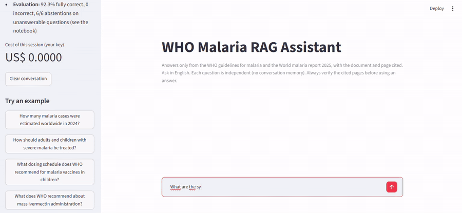

# LLM & RAG — Question Answering over WHO Malaria Documents

> 🇧🇷 Versão em português: [README_pt-BR.md](README_pt-BR.md)
> Part of [data-science-portfolio](../README.md)
> Notebook: [05_llm_rag_pdf_chatbot.ipynb](notebooks/05_llm_rag_pdf_chatbot.ipynb)
> Status: Completed
> [](https://github.com/marcus-vinicius-jr/data-science-portfolio/actions/workflows/ci-05-llm-rag-pdf-chatbot.yml)

This project builds and evaluates a **Retrieval-Augmented Generation (RAG) assistant** over three public WHO documents
(the *WHO guidelines for malaria*, the *World malaria report 2025* and its executive summary; 727 pages in total). It is framed
from the perspective of the Head of a National Malaria Control Programme, who needs fast answers **with the document and page
cited**, and for whom a confident but wrong answer is worse than "I could not find it".

The notebook combines:
- modelling hypotheses stated before building anything,
- PDF ingestion with an extraction-quality audit (chart glyph names, repeated footers) and recursive chunking,
- two embedding models compared head to head, **OpenAI `text-embedding-3-small`** vs. the local **`BAAI/bge-small-en-v1.5`**,
  stored in **Chroma**, plus a **BM25** term-based baseline and **hybrid search** with Reciprocal Rank Fusion,
- a **hand-labelled evaluation set** (45 questions, including questions the documents cannot answer), with retrieval measured on
  its own (hit rate@k, MRR, context precision) before any generation,
- generation with `gpt-4.1-mini` and a **grounding prompt** (answer only from context, cite every claim, fixed abstention
  sentence), compared against a **closed-book** baseline,
- answer evaluation with an **AI judge** (`gpt-4.1`, categorical rubric) for correctness and faithfulness, cross-checked against a
  judge-independent key-term signal, plus **citation validity**, latency and cost,
- error analysis separating retrieval failures from generation failures, and
- business storytelling: findings, a recommended configuration and operating rules for the programme.

The design follows *AI Engineering* (Chip Huyen, 2025), chapter 6 (RAG) and chapters 3-4 (evaluation). A local
[Streamlit chat](#local-chat-app) (`app.py`) shows the recommended configuration in use.

---

## Business Question

Can a RAG assistant built on the WHO malaria documents answer a national malaria programme's questions faithfully enough to
replace manual PDF search for routine look-ups, and does a free, locally run embedding model retrieve the right passages as well
as OpenAI's paid embedding model?

---

## Dataset (corpus)

| Document | Source | Pages | Characters |
|---|---|---|---|
| WHO guidelines for malaria | [WHO](https://www.who.int/publications/i/item/guidelines-for-malaria) | 494 | 1,920,279 |
| World malaria report 2025 | [WHO](https://www.who.int/publications/i/9789240117822) | 212 | 677,601 |
| WMR 2025 executive summary | [WHO](https://www.who.int/publications/m/item/executive-summary-world-malaria-report-2025) | 21 | 32,725 |

- Licence: CC BY-NC-SA 3.0 IGO (World Health Organization). The PDFs are downloaded by the notebook into `data/raw/`.
- After cleaning: 714 pages, **3,305 chunks** of up to 1,000 characters (150 overlap), 714,802 tokens.
- Evaluation set: [`eval/eval_questions.csv`](eval/eval_questions.csv), 45 questions written by hand from the PDFs before any
  retrieval was run: 19 guideline recommendations, 20 World malaria report statistics, 6 unanswerable questions (verified absent
  by full-text search). Each answerable question has a reference answer, verbatim evidence phrases and key terms.

---

## Methodology Summary

1. Setup: models, API key from `.env`, LLM response cache
2. Corpus acquisition and understanding (page profile, extraction artefacts removed)
3. Chunking (recursive, 1,000 characters, token distribution for both tokenizers, cost estimate)
4. Indexing: local `bge-small` and OpenAI embeddings in two Chroma collections
5. Evaluation set design (answer-bearing chunks found automatically from evidence phrases)
6. Retrieval evaluation: BM25, dense local vs. OpenAI (H1), hybrid RRF (H3), by category
7. Generation: grounding prompt, LangChain RAG chain, closed-book baseline
8. Answer evaluation: AI-judge rubric, correctness and faithfulness (H2), abstention (H4), judge sanity check, citation
   quality, latency and cost
9. Error analysis: retrieval vs. generation failures
10. Business storytelling: demo, hypotheses and results, key findings, recommendation
11. Conclusions and next steps

---

## Retrieval Results (39 answerable questions, top 10 per retriever)

| Retriever | hit@1 | hit@3 | hit@5 | MRR@5 | precision@5 | Latency / query |
|---|---|---|---|---|---|---|
| BM25 | 0.5641 | 0.7179 | 0.8205 | 0.6611 | 0.3179 | 13 ms |
| Dense, local `bge-small` | 0.5641 | 0.7692 | 0.8974 | 0.6833 | 0.2923 | 51 ms |
| **Dense, OpenAI `text-embedding-3-small`** | 0.5128 | 0.8974 | **0.9231** | 0.7115 | 0.3436 | 320 ms |
| Hybrid, BM25 + local (RRF) | **0.6154** | 0.8974 | 0.8974 | **0.7521** | 0.3231 | 58 ms |
| Hybrid, BM25 + OpenAI (RRF) | 0.5897 | 0.8205 | 0.8974 | 0.7201 | **0.3538** | 324 ms |

Report statistics are easy for every retriever (hit@5 of 0.95 to 1.00); the differences come from guideline recommendations,
which are paraphrased in the questions (BM25 0.6842 vs. OpenAI 0.8947).

## Answer Results (AI judge, 39 answerable + 6 unanswerable questions)

| Configuration | Strict accuracy | Lenient accuracy | Incorrect | Faithfulness | Abstention on unanswerable | Cost / 1,000 questions |
|---|---|---|---|---|---|---|
| Closed-book (no retrieval) | 0.2308 | 0.3590 | 0.3846 | n/a | 1 of 6 (16.67%) | US$ 0.17 |
| RAG, dense local | 0.8462 | 0.8846 | 0.0769 | 0.9744 | 5 of 6 (83.33%) | US$ 0.63 |
| **RAG, dense OpenAI** | **0.9231** | **0.9615** | **0.0000** | 0.9737 | **6 of 6 (100%)** | US$ 0.64 |
| RAG, hybrid (BM25 + local) | 0.8718 | 0.9103 | 0.0513 | **1.0000** | **6 of 6 (100%)** | US$ 0.65 |

Strict accuracy counts only `correct`; lenient also counts `partially_correct` as half a point. On World malaria report 2025
statistics specifically, closed-book accuracy is **5.00% (1 of 20)** against 90.00% to 95.00% with RAG.

The AI judge agreed with an independent key-term check on 87.42% of 151 answers (Cohen's kappa 0.6573); the disagreements are the
judge penalising omitted qualifiers or accepting paraphrases. A full evaluation run from scratch (indexing, 180 answers, 180
judgments) costs **US$ 0.72**.

---

## Hypotheses & Results

| # | Hypothesis | Result |
|---|---|---|
| H1 | OpenAI embeddings retrieve better than the local `bge-small` model | **Confirmed, by a small margin.** hit@5 0.9231 vs. 0.8974 (one question of 39), MRR@5 0.7115 vs. 0.6833; end to end, strict accuracy 92.31% vs. 84.62%. The local model is 6.2 times faster per query (51 ms vs. 320 ms) but took 20.5 times longer to index (813 s vs. 40 s). |
| H2 | RAG answers are more often correct than closed-book answers, especially for World malaria report statistics | **Confirmed.** Strict accuracy 84.62% to 92.31% with RAG vs. 23.08% closed-book; on report statistics, 90.00% to 95.00% vs. 5.00%. |
| H3 | Hybrid search (BM25 + dense, RRF) beats the best dense-only retriever | **Partially confirmed.** Not on hit@5 (0.8974 vs. 0.9231), but the local hybrid has the best MRR@5 (0.7521) and hit@1 (0.6154). End to end it did not beat dense OpenAI retrieval (87.18% vs. 92.31%). |
| H4 | RAG abstains on unanswerable questions more often than closed-book | **Confirmed.** 83.33% to 100% with RAG vs. 16.67%; the closed-book model gave confident answers to 5 of the 6 unanswerable questions (e.g. a dosing schedule for the dengue vaccine TAK-003). |

---

## Key Findings

- **Grounding changes the risk profile more than any model choice**: without retrieval the same LLM was wrong on 38.46% of
  answerable questions and invented answers to 5 of 6 unanswerable ones; the best RAG configuration had **0 incorrect answers in
  39** and declined all 6 unanswerable questions.
- **The documents are the only source for recent figures**: on World malaria report 2025 statistics, closed-book accuracy is
  5.00% (1 of 20) against up to 95.00% with RAG.
- **The paid embedding model wins, but only just**: OpenAI embeddings found the evidence for one more question at hit@5 and led
  to 3 more correct answers end to end, for US$ 0.0143 per full index; the free local model is a credible fallback.
- **Hybrid search improved ranking, not answers**: best MRR@5 (0.7521) and best accuracy on report statistics (95.00%), but
  lower end-to-end accuracy (87.18%) than dense OpenAI retrieval (92.31%).
- **Remaining errors are omissions and misreadings, not inventions**: faithfulness 97% to 100%; the 14 non-correct RAG answers
  came from dropped qualifiers, a sentence split by a figure caption in the PDF, a misattributed list and missing passages.
- **Citations are always present but not always exact**: 100% of RAG answers cite `[document, p. N]`, but 14.4% cite at least one
  page the model never saw, mostly passage numbers turned into page numbers (10 cases) or the report confused with its executive
  summary (8 cases).
- **The RAG system caught an error in the human gold set**: a question labelled "unanswerable" (vaccine price) was answered by all
  RAG configurations from a cost-effectiveness passage the keyword search had missed; the label was corrected and documented.

---

## Recommended Configuration

- **Retrieval:** OpenAI `text-embedding-3-small`, top 5 chunks of 1,000 characters, Chroma vector store
- **Generation:** `gpt-4.1-mini` with the grounding prompt (context only, citations, fixed abstention sentence)
- **Measured performance:** 92.31% strict accuracy, 0 incorrect answers, 100% abstention on unanswerable questions, about 1.1 to
  1.4 s and US$ 0.64 per 1,000 questions
- **Operating rules:** use it to find and draft, not to publish (verify every cited page before it reaches a policy brief);
  treat "Not found in the provided documents." as a real answer; always open the cited page for dosing and eligibility
  questions; add the citation validator as a production guardrail; re-run the evaluation for every new WHO edition (US$ 0.72)

---

## Repository Structure

```text
05_llm_rag_pdf_chatbot/
|-- data/                                    # gitignored
|   |-- raw/                                 # WHO PDFs downloaded by the notebook
|   `-- processed/                           # Chroma collections, cached embeddings, LLM cache, run stats
|-- docs/
|   `-- chat_demo.gif                        # demo of the local chat app
|-- eval/
|   `-- eval_questions.csv                   # hand-labelled evaluation set (versioned)
|-- notebooks/
|   `-- 05_llm_rag_pdf_chatbot.ipynb
|-- tests/
|   `-- test_project.py                      # free CI checks (no API key)
|-- app.py                                   # local Streamlit chat (recommended configuration)
|-- requirements.txt
|-- .gitignore
|-- README.md
`-- README_pt-BR.md
```

---

## How to Run

**Requirements.**
- **Python 3.11 or newer**: Streamlit requires Python ≥ 3.11, and PyTorch, sentence-transformers, transformers, the LangChain
  packages and the OpenAI SDK require ≥ 3.10 (per each package's published metadata). The
  [sentence-transformers installation guide](https://sbert.net/docs/installation.html) recommends PyTorch 2.2+ and
  transformers v5.0+.
- **No GPU needed.** The local model [`BAAI/bge-small-en-v1.5`](https://huggingface.co/BAAI/bge-small-en-v1.5) has 33.4M
  parameters (about 130 MB of weights) and its model card lists no hardware requirements; it runs on CPU. A GPU is optional and
  needs a CUDA build of PyTorch.
- **Internet access and your own OpenAI API key.**
- **Disk space:** 1 to 1.5 GB (about 540 MB for CPU-only PyTorch, the other libraries, the local embedding model and about
  120 MB of generated data).

1. Go to the project folder:

```bash
cd 05_llm_rag_pdf_chatbot
```

2. Create and activate a virtual environment (optional if you already use conda):

```bash
python -m venv venv
venv\Scripts\activate
```

3. Install CPU-only PyTorch first (smaller than the default build), then the dependencies:

```bash
pip install torch --index-url https://download.pytorch.org/whl/cpu
pip install -r requirements.txt
```

4. Add your OpenAI API key to a `.env` file at the **repository root** (it is gitignored):

```text
OPENAI_API_KEY=sk-...
```

5. Open and run:

```text
notebooks/05_llm_rag_pdf_chatbot.ipynb
```

The first run downloads the PDFs and the local embedding model and builds both indexes (about 14 minutes for the local model on
CPU, faster with more cores; 40 seconds for OpenAI). Embeddings, retrieval runs and every LLM response are cached in `data/processed/`,
so later runs take a few minutes and cost nothing.

---

## Local Chat App



[`app.py`](app.py) is a small **Streamlit** chat built on the configuration recommended by the evaluation (OpenAI
`text-embedding-3-small` retrieval, top 5 chunks, `gpt-4.1-mini` with the grounding prompt). It shows the assistant in use:
type a question and get a short answer with `[document, p. N]` citations, plus an expandable **Sources** panel with the text of
each retrieved passage, so every statement can be checked on the spot.

Run it from the repository root (after steps 3 and 4 above):

```bash
streamlit run 05_llm_rag_pdf_chatbot/app.py
```

The browser opens at `http://localhost:8501`. Stop it with `Ctrl+C` in the terminal.

- **Your own key only.** The app reads `OPENAI_API_KEY` from the `.env` of the person running it and is meant to run locally;
  there is no public deployment, so nobody else can spend your credits. Without a key, it shows how to set one up instead of
  starting. Each question costs about US$ 0.0006, and the sidebar shows the running cost of the session.
- **No notebook needed.** The app reuses the OpenAI Chroma collection in `data/processed/chroma/`. If it does not exist yet
  (for example, right after cloning), the app offers a **Build the index** button that downloads the PDFs and embeds the 3,305
  chunks (about 1 minute and US$ 0.01 on your key). The notebook is only needed to reproduce the evaluation.
- **Ask in English**, one question at a time: there is no conversation memory, so follow-up questions must be self-contained.
  The sidebar has example questions, including one the documents cannot answer, to show the abstention behaviour.
- Do not run the app while the notebook kernel is writing to the same Chroma folder.

---

## Notes

- Never commit the `.env` file or API keys; `.env` is ignored both at the repository root and in this folder.
- The PDFs, Chroma collections, embedding matrices and the LLM response cache are generated locally and excluded via
  `.gitignore`; run the notebook again to regenerate them.
- **Cost:** one full run from scratch costs about US$ 0.72 (85% of it is the `gpt-4.1` judge). Prices used in the notebook are
  OpenAI list prices at the time of writing and are declared as an assumption.
- **Reproducibility:** generation and judging use temperature 0 and a fixed seed, and responses are cached by a hash of the exact
  prompt. Without the cache, LLM outputs can still vary slightly between runs.
- **One gold label was corrected after the first run** (G19, originally the unanswerable U03), because the RAG system found a
  passage the human keyword search had missed. This is documented in the notebook (section 5.1); no other label was changed.
- The evaluation set is small (39 answerable questions, so one question moves a rate by 2.56 points) and written by one person;
  differences of one or two questions between configurations are suggestive, not statistically established.
- Correctness relies on an AI judge, validated against a key-term check (87.42% agreement) but not against a panel of human experts.
- Text inside charts, maps and some tables is lost or garbled by PDF extraction, so figure-only facts are out of reach.
- Page numbers in citations are the PDF page index (as shown by a PDF viewer), which differs from the printed page number in the
  World malaria report.
- The local embedding model runs on CPU; generation always uses the OpenAI API, so the local option removes the external
  dependency from retrieval only.
- **CI, split by cost:** [`.github/workflows/ci-05-llm-rag-pdf-chatbot.yml`](../.github/workflows/ci-05-llm-rag-pdf-chatbot.yml)
  has two jobs.
  - `checks` runs on every push/PR that touches this folder, **without an API key and at no cost**:
    [`tests/test_project.py`](tests/test_project.py) validates the evaluation set, confirms the committed notebook ran without
    errors and contains no API key, and runs the chat app without a key to confirm it asks for one instead of failing. The badge
    above reflects this job. Run the same checks locally with `pytest tests`.
  - `evaluation` re-runs the whole notebook against the OpenAI API (about US$ 0.72 per run, since CI starts without a cache).
    It only runs when triggered manually (Actions → *CI - 05 LLM RAG PDF Chatbot* → *Run workflow*) and needs the repository
    secret `OPENAI_API_KEY` (Settings → Secrets and variables → Actions); a key from a separate OpenAI project with a low
    spending limit is recommended.

---

> Back to portfolio: [data-science-portfolio](../README.md)
