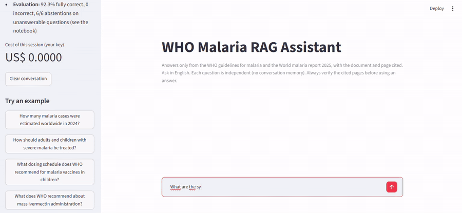

# LLM & RAG — Perguntas e Respostas sobre Documentos da OMS sobre Malária

> 🇺🇸 English version: [README.md](README.md)
> Parte do [data-science-portfolio](../README_pt-BR.md)
> Notebook: [05_llm_rag_pdf_chatbot.ipynb](notebooks/05_llm_rag_pdf_chatbot.ipynb)
> Status: Concluído
> [](https://github.com/marcus-vinicius-jr/data-science-portfolio/actions/workflows/ci-05-llm-rag-pdf-chatbot.yml)

Este projeto constrói e avalia um **assistente de Retrieval-Augmented Generation (RAG)** sobre três documentos públicos da OMS
(as *WHO guidelines for malaria*, o *World malaria report 2025* e seu resumo executivo; 727 páginas no total), com a
perspectiva de um(a) gestor(a) de Programa Nacional de Controle da Malária, que precisa de respostas rápidas **com documento e
página citados**, e para quem uma resposta confiante porém errada é pior do que "não encontrei".

O notebook combina:
- hipóteses de modelagem definidas antes de construir qualquer coisa,
- ingestão de PDFs com auditoria da qualidade da extração (nomes de glifos de gráficos, rodapés repetidos) e chunking recursivo,
- dois modelos de embedding comparados lado a lado, **OpenAI `text-embedding-3-small`** vs. o modelo local
  **`BAAI/bge-small-en-v1.5`**, armazenados no **Chroma**, além de um baseline term-based **BM25** e **busca híbrida** com
  Reciprocal Rank Fusion,
- um **conjunto de avaliação rotulado à mão** (45 perguntas, incluindo perguntas que os documentos não conseguem responder), com a
  busca medida isoladamente (hit rate@k, MRR, context precision) antes de qualquer geração,
- geração com `gpt-4.1-mini` e um **prompt de grounding** (responder só a partir do contexto, citar cada afirmação, frase fixa de
  abstenção), comparada a um baseline **closed-book** (sem busca),
- avaliação das respostas com um **AI judge** (`gpt-4.1`, rubrica categórica) para correção e fidelidade, validado contra um sinal
  independente de termos-chave, além de **validade das citações**, latência e custo,
- análise de erros separando falhas de busca de falhas de geração, e
- storytelling de negócio: achados, configuração recomendada e regras de operação para o programa.

O desenho segue o *AI Engineering* (Chip Huyen, 2025), capítulo 6 (RAG) e capítulos 3-4 (avaliação). Um
[chat local em Streamlit](#chat-local) (`app.py`) mostra a configuração recomendada em uso.

---

## Pergunta de Negócio

Um assistente RAG construído sobre os documentos da OMS sobre malária consegue responder às perguntas de um programa nacional de
malária com fidelidade suficiente para substituir a busca manual nos PDFs em consultas de rotina, e um modelo de embedding local
e gratuito recupera os trechos certos tão bem quanto o modelo pago da OpenAI?

---

## Dataset (corpus)

| Documento | Fonte | Páginas | Caracteres |
|---|---|---|---|
| WHO guidelines for malaria | [OMS](https://www.who.int/publications/i/item/guidelines-for-malaria) | 494 | 1.920.279 |
| World malaria report 2025 | [OMS](https://www.who.int/publications/i/9789240117822) | 212 | 677.601 |
| Resumo executivo do WMR 2025 | [OMS](https://www.who.int/publications/m/item/executive-summary-world-malaria-report-2025) | 21 | 32.725 |

- Licença: CC BY-NC-SA 3.0 IGO (Organização Mundial da Saúde). Os PDFs são baixados pelo próprio notebook para `data/raw/`.
- Após a limpeza: 714 páginas, **3.305 chunks** de até 1.000 caracteres (sobreposição de 150), 714.802 tokens.
- Conjunto de avaliação: [`eval/eval_questions.csv`](eval/eval_questions.csv), 45 perguntas escritas à mão a partir dos PDFs
  antes de rodar qualquer busca: 19 recomendações das diretrizes, 20 estatísticas do World malaria report, 6 perguntas sem
  resposta no corpus (ausência verificada por busca no texto completo). Cada pergunta respondível tem resposta de referência,
  trechos literais de evidência e termos-chave.

---

## Resumo da Metodologia

1. Setup: modelos, chave da API via `.env`, cache de respostas da LLM
2. Aquisição e entendimento do corpus (perfil de páginas, artefatos de extração removidos)
3. Chunking (recursivo, 1.000 caracteres, distribuição de tokens nos dois tokenizadores, estimativa de custo)
4. Indexação: embeddings locais `bge-small` e da OpenAI em duas coleções do Chroma
5. Desenho do conjunto de avaliação (chunks com a resposta encontrados automaticamente a partir das evidências)
6. Avaliação da busca: BM25, denso local vs. OpenAI (H1), híbrido RRF (H3), por categoria
7. Geração: prompt de grounding, chain RAG com LangChain, baseline closed-book
8. Avaliação das respostas: rubrica do AI judge, correção e fidelidade (H2), abstenção (H4), checagem do judge, qualidade das
   citações, latência e custo
9. Análise de erros: falhas de busca vs. de geração
10. Storytelling de negócio: demo, hipóteses e resultados, principais achados, recomendação
11. Conclusões e próximos passos

---

## Resultados da Busca (39 perguntas respondíveis, top 10 por retriever)

| Retriever | hit@1 | hit@3 | hit@5 | MRR@5 | precision@5 | Latência / consulta |
|---|---|---|---|---|---|---|
| BM25 | 0,5641 | 0,7179 | 0,8205 | 0,6611 | 0,3179 | 13 ms |
| Denso, local `bge-small` | 0,5641 | 0,7692 | 0,8974 | 0,6833 | 0,2923 | 51 ms |
| **Denso, OpenAI `text-embedding-3-small`** | 0,5128 | 0,8974 | **0,9231** | 0,7115 | 0,3436 | 320 ms |
| Híbrido, BM25 + local (RRF) | **0,6154** | 0,8974 | 0,8974 | **0,7521** | 0,3231 | 58 ms |
| Híbrido, BM25 + OpenAI (RRF) | 0,5897 | 0,8205 | 0,8974 | 0,7201 | **0,3538** | 324 ms |

Estatísticas do relatório são fáceis para todos os retrievers (hit@5 de 0,95 a 1,00); as diferenças vêm das recomendações das
diretrizes, que aparecem parafraseadas nas perguntas (BM25 0,6842 vs. OpenAI 0,8947).

## Resultados das Respostas (AI judge, 39 respondíveis + 6 sem resposta)

| Configuração | Acurácia estrita | Acurácia leniente | Incorretas | Fidelidade | Abstenção nas sem resposta | Custo / 1.000 perguntas |
|---|---|---|---|---|---|---|
| Closed-book (sem busca) | 0,2308 | 0,3590 | 0,3846 | n/a | 1 de 6 (16,67%) | US$ 0,17 |
| RAG, denso local | 0,8462 | 0,8846 | 0,0769 | 0,9744 | 5 de 6 (83,33%) | US$ 0,63 |
| **RAG, denso OpenAI** | **0,9231** | **0,9615** | **0,0000** | 0,9737 | **6 de 6 (100%)** | US$ 0,64 |
| RAG, híbrido (BM25 + local) | 0,8718 | 0,9103 | 0,0513 | **1,0000** | **6 de 6 (100%)** | US$ 0,65 |

A acurácia estrita conta só `correct`; a leniente também conta `partially_correct` como meio ponto. Especificamente nas
estatísticas do World malaria report 2025, a acurácia closed-book é de **5,00% (1 de 20)**, contra 90,00% a 95,00% com RAG.

O AI judge concordou com uma checagem independente por termos-chave em 87,42% de 151 respostas (kappa de Cohen 0,6573); as
discordâncias são o judge penalizando ressalvas omitidas ou aceitando paráfrases. Uma execução completa da avaliação do zero
(indexação, 180 respostas, 180 julgamentos) custa **US$ 0,72**.

---

## Hipóteses & Resultados

| # | Hipótese | Resultado |
|---|---|---|
| H1 | Os embeddings da OpenAI recuperam melhor que o modelo local `bge-small` | **Confirmada, por pouco.** hit@5 0,9231 vs. 0,8974 (uma pergunta de 39), MRR@5 0,7115 vs. 0,6833; ponta a ponta, acurácia estrita 92,31% vs. 84,62%. O modelo local é 6,2 vezes mais rápido por consulta (51 ms vs. 320 ms), mas levou 20,5 vezes mais tempo para indexar (813 s vs. 40 s). |
| H2 | Respostas com RAG são corretas com mais frequência que as closed-book, principalmente nas estatísticas do World malaria report | **Confirmada.** Acurácia estrita de 84,62% a 92,31% com RAG vs. 23,08% closed-book; nas estatísticas do relatório, 90,00% a 95,00% vs. 5,00%. |
| H3 | Busca híbrida (BM25 + denso, RRF) supera o melhor retriever só denso | **Parcialmente confirmada.** Não em hit@5 (0,8974 vs. 0,9231), mas o híbrido local tem o melhor MRR@5 (0,7521) e hit@1 (0,6154). Ponta a ponta, não superou a busca densa da OpenAI (87,18% vs. 92,31%). |
| H4 | O RAG se abstém em perguntas sem resposta com mais frequência que o closed-book | **Confirmada.** 83,33% a 100% com RAG vs. 16,67%; o modelo closed-book deu respostas confiantes a 5 das 6 perguntas sem resposta (ex.: um esquema de doses para a vacina de dengue TAK-003). |

---

## Principais Achados

- **O grounding muda o perfil de risco mais do que qualquer escolha de modelo**: sem busca, a mesma LLM errou 38,46% das
  perguntas respondíveis e inventou respostas para 5 das 6 sem resposta; a melhor configuração RAG teve **0 respostas incorretas
  em 39** e recusou as 6 perguntas sem resposta.
- **Os documentos são a única fonte para números recentes**: nas estatísticas do World malaria report 2025, a acurácia
  closed-book é de 5,00% (1 de 20), contra até 95,00% com RAG.
- **O embedding pago vence, mas por pouco**: os embeddings da OpenAI encontraram a evidência de uma pergunta a mais no hit@5 e
  geraram 3 respostas corretas a mais ponta a ponta, por US$ 0,0143 por indexação completa; o modelo local gratuito é uma
  alternativa crível.
- **A busca híbrida melhorou o ranking, não as respostas**: melhor MRR@5 (0,7521) e melhor acurácia nas estatísticas do relatório
  (95,00%), mas acurácia ponta a ponta menor (87,18%) que a busca densa da OpenAI (92,31%).
- **Os erros restantes são omissões e leituras equivocadas, não invenções**: fidelidade de 97% a 100%; as 14 respostas RAG não
  corretas vieram de ressalvas omitidas, uma frase cortada pela legenda de uma figura no PDF, uma lista mal atribuída e trechos
  que não foram recuperados.
- **As citações estão sempre presentes, mas nem sempre exatas**: 100% das respostas RAG citam `[documento, p. N]`, mas 14,4% citam
  ao menos uma página que o modelo não viu, principalmente números de trecho virando número de página (10 casos) ou o relatório
  confundido com seu resumo executivo (8 casos).
- **O sistema RAG encontrou um erro no gabarito humano**: uma pergunta rotulada como "sem resposta" (preço da vacina) foi
  respondida por todas as configurações RAG a partir de um trecho de custo-efetividade que a busca por palavra-chave não tinha
  encontrado; o rótulo foi corrigido e documentado.

---

## Configuração Recomendada

- **Busca:** OpenAI `text-embedding-3-small`, top 5 chunks de 1.000 caracteres, vector store Chroma
- **Geração:** `gpt-4.1-mini` com o prompt de grounding (só contexto, citações, frase fixa de abstenção)
- **Desempenho medido:** 92,31% de acurácia estrita, 0 respostas incorretas, 100% de abstenção nas perguntas sem resposta, cerca
  de 1,1 a 1,4 s e US$ 0,64 por 1.000 perguntas
- **Regras de operação:** usar para encontrar e rascunhar, não para publicar (conferir cada página citada antes de ir para um
  documento oficial); tratar "Not found in the provided documents." como resposta válida; sempre abrir a página citada em
  perguntas de dose e elegibilidade; adicionar o validador de citações como guardrail em produção; reexecutar a avaliação a cada
  nova edição da OMS (US$ 0,72)

---

## Estrutura do Repositório

```text
05_llm_rag_pdf_chatbot/
|-- data/                                    # gitignored
|   |-- raw/                                 # PDFs da OMS baixados pelo notebook
|   `-- processed/                           # coleções Chroma, embeddings em cache, cache da LLM, estatísticas
|-- docs/
|   `-- chat_demo.gif                        # demo do chat local
|-- eval/
|   `-- eval_questions.csv                   # conjunto de avaliação rotulado à mão (versionado)
|-- notebooks/
|   `-- 05_llm_rag_pdf_chatbot.ipynb
|-- tests/
|   `-- test_project.py                      # checagens gratuitas do CI (sem chave de API)
|-- app.py                                   # chat local em Streamlit (configuração recomendada)
|-- requirements.txt
|-- .gitignore
|-- README.md
`-- README_pt-BR.md
```

---

## Como Executar

**Requisitos.**
- **Python 3.11 ou mais recente**: o Streamlit exige Python ≥ 3.11, e PyTorch, sentence-transformers, transformers, os pacotes
  LangChain e o SDK da OpenAI exigem ≥ 3.10 (conforme os metadados publicados de cada pacote). O
  [guia de instalação do sentence-transformers](https://sbert.net/docs/installation.html) recomenda PyTorch 2.2+ e
  transformers v5.0+.
- **Não precisa de GPU.** O modelo local [`BAAI/bge-small-en-v1.5`](https://huggingface.co/BAAI/bge-small-en-v1.5) tem 33,4M
  de parâmetros (cerca de 130 MB de pesos) e seu model card não lista requisitos de hardware; ele roda em CPU. GPU é opcional e
  exige o PyTorch com CUDA.
- **Acesso à internet e a sua própria chave da OpenAI.**
- **Espaço em disco:** de 1 a 1,5 GB (cerca de 540 MB para o PyTorch só para CPU, as demais bibliotecas, o modelo de embedding
  local e cerca de 120 MB de dados gerados).

1. Vá até a pasta do projeto:

```bash
cd 05_llm_rag_pdf_chatbot
```

2. Crie e ative um ambiente virtual (opcional se já usa conda):

```bash
python -m venv venv
venv\Scripts\activate
```

3. Instale primeiro o PyTorch só para CPU (mais leve que o padrão) e depois as dependências:

```bash
pip install torch --index-url https://download.pytorch.org/whl/cpu
pip install -r requirements.txt
```

4. Coloque sua chave da OpenAI em um arquivo `.env` na **raiz do repositório** (ignorado pelo Git):

```text
OPENAI_API_KEY=sk-...
```

5. Abra e execute:

```text
notebooks/05_llm_rag_pdf_chatbot.ipynb
```

A primeira execução baixa os PDFs e o modelo de embedding local e constrói os dois índices (cerca de 14 minutos para o modelo
local em CPU, mais rápido com mais núcleos; 40 segundos para a OpenAI). Embeddings, resultados da busca e todas as respostas da
LLM ficam em cache em `data/processed/`, então as execuções seguintes levam poucos minutos e não custam nada.

---

## Chat Local



O [`app.py`](app.py) é um pequeno chat em **Streamlit** construído sobre a configuração recomendada pela avaliação (busca com
`text-embedding-3-small` da OpenAI, top 5 chunks, `gpt-4.1-mini` com o prompt de grounding). Ele mostra o assistente em uso:
você digita uma pergunta e recebe uma resposta curta com citações `[documento, p. N]`, além de um painel **Sources** expansível
com o texto de cada trecho recuperado, para conferir cada afirmação na hora.

Execute a partir da raiz do repositório (depois dos passos 3 e 4 acima):

```bash
streamlit run 05_llm_rag_pdf_chatbot/app.py
```

O navegador abre em `http://localhost:8501`. Para encerrar, use `Ctrl+C` no terminal.

- **Só com a sua própria chave.** O app lê a `OPENAI_API_KEY` do `.env` de quem o executa e foi feito para rodar localmente;
  não há publicação online, então ninguém mais consegue gastar os seus créditos. Sem chave, ele mostra como configurar em vez de
  iniciar. Cada pergunta custa cerca de US$ 0,0006, e a barra lateral mostra o custo acumulado da sessão.
- **Não precisa do notebook.** O app reaproveita a coleção do Chroma da OpenAI em `data/processed/chroma/`. Se ela ainda não
  existir (por exemplo, logo após clonar o repositório), o app oferece um botão **Build the index** que baixa os PDFs e gera os
  embeddings dos 3.305 chunks (cerca de 1 minuto e US$ 0,01 na sua chave). O notebook só é necessário para reproduzir a
  avaliação.
- **Pergunte em inglês**, uma pergunta por vez: não há memória de conversa, então perguntas de acompanhamento precisam ser
  completas. A barra lateral tem perguntas de exemplo, incluindo uma que os documentos não respondem, para mostrar a abstenção.
- Não rode o app enquanto o kernel do notebook estiver gravando na mesma pasta do Chroma.

---

## Observações

- Nunca commitar o arquivo `.env` nem chaves de API; o `.env` é ignorado tanto na raiz do repositório quanto nesta pasta.
- Os PDFs, as coleções do Chroma, as matrizes de embeddings e o cache de respostas da LLM são gerados localmente e excluídos via
  `.gitignore`; execute o notebook novamente para regerá-los.
- **Custo:** uma execução completa do zero custa cerca de US$ 0,72 (85% disso é o judge `gpt-4.1`). Os preços usados no notebook
  são os preços de tabela da OpenAI no momento da escrita e estão declarados como premissa.
- **Reprodutibilidade:** geração e julgamento usam temperatura 0 e seed fixa, e as respostas ficam em cache pelo hash do prompt
  exato. Sem o cache, as saídas da LLM ainda podem variar levemente entre execuções.
- **Um rótulo do gabarito foi corrigido após a primeira execução** (G19, originalmente a pergunta sem resposta U03), porque o
  sistema RAG encontrou um trecho que a busca humana por palavra-chave não tinha encontrado. Isso está documentado no notebook
  (seção 5.1); nenhum outro rótulo foi alterado.
- O conjunto de avaliação é pequeno (39 perguntas respondíveis, então uma pergunta muda uma taxa em 2,56 pontos) e foi escrito
  por uma pessoa; diferenças de uma ou duas perguntas entre configurações são indicativas, não estatisticamente estabelecidas.
- A correção depende de um AI judge, validado contra uma checagem de termos-chave (87,42% de concordância), mas não contra um
  painel de especialistas humanos.
- Texto dentro de gráficos, mapas e algumas tabelas se perde ou sai corrompido na extração do PDF, então fatos que só existem em
  figuras ficam fora de alcance.
- Os números de página nas citações são o índice da página no PDF (como mostrado por um leitor de PDF), que difere do número
  impresso no World malaria report.
- O modelo de embedding local roda em CPU; a geração sempre usa a API da OpenAI, então a opção local remove a dependência externa
  apenas da busca.
- **CI separado por custo:** [`.github/workflows/ci-05-llm-rag-pdf-chatbot.yml`](../.github/workflows/ci-05-llm-rag-pdf-chatbot.yml)
  tem dois jobs.
  - `checks` roda a cada push/PR que toque esta pasta, **sem chave de API e sem custo**:
    [`tests/test_project.py`](tests/test_project.py) valida o conjunto de avaliação, confirma que o notebook versionado rodou sem
    erros e não contém chave de API, e executa o chat sem chave para confirmar que ele pede a configuração em vez de falhar. O
    badge acima reflete este job. Rode as mesmas checagens localmente com `pytest tests`.
  - `evaluation` reexecuta o notebook inteiro com a API da OpenAI (cerca de US$ 0,72 por execução, já que o CI começa sem
    cache). Ele só roda quando disparado manualmente (Actions → *CI - 05 LLM RAG PDF Chatbot* → *Run workflow*) e precisa do
    secret do repositório `OPENAI_API_KEY` (Settings → Secrets and variables → Actions); recomenda-se uma chave de um projeto
    separado da OpenAI com limite de gasto baixo.

---

> Voltar ao portfólio: [data-science-portfolio](../README_pt-BR.md)
